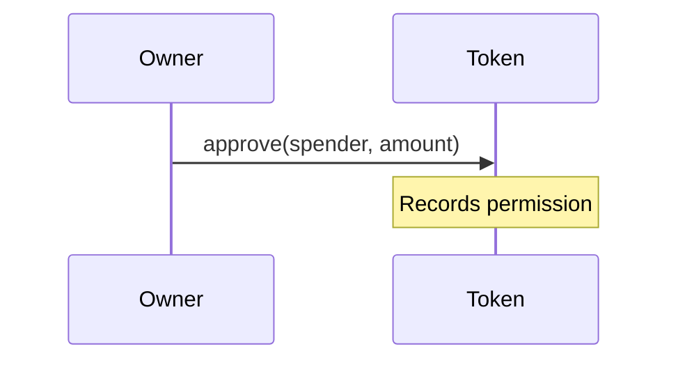
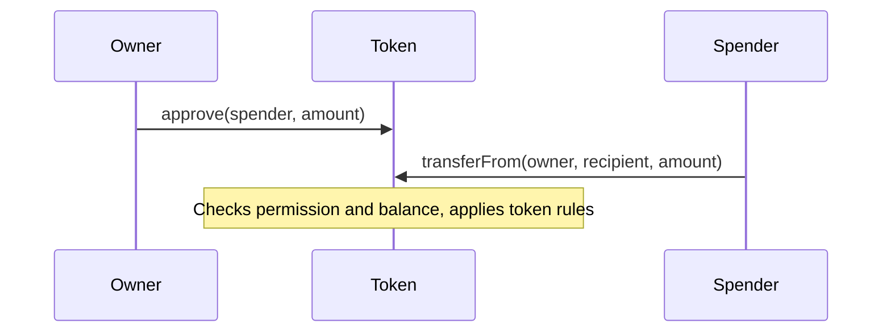
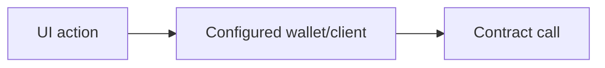
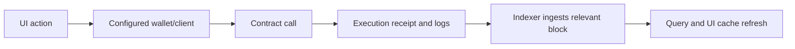

# Diagrams that explain a mechanism

Use only the stages needed to answer the learner's question. Diagrams below are teaching sketches, not evidence about a particular application. Substitute observed project symbols and cite their source locations when describing a real flow. A diagram does not justify a runtime success claim.

## Allowance and transfer

For “what is approval?”, a short account may suffice: the token owner grants a spender permission to move up to an amount. Approval changes that permission; the spender's later `transferFrom` attempts the movement under the token's rules. Approval alone does not move the tokens.

Add the spending step only when the learner needs it:

This sketch omits nonstandard token behavior and application-specific checks. Explain those only when relevant to the learner's token or integration.

## A project transaction and its displayed result

First identify the actual caller and target. For example:

When the learner asks why the screen still looks stale, extend the picture with evidenced observation stages:

Use this second diagram only if an indexer participates. A direct contract read follows a different path. Label missing links as unverified rather than inventing an event handler or refresh mechanism. Explain where the project actually checks execution outcome and where latency can occur. Confirmation/finality requirements depend on the application and network; a receipt alone does not establish every downstream stage.
